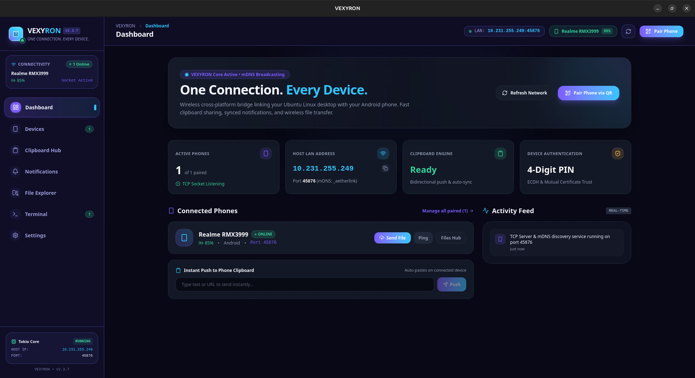
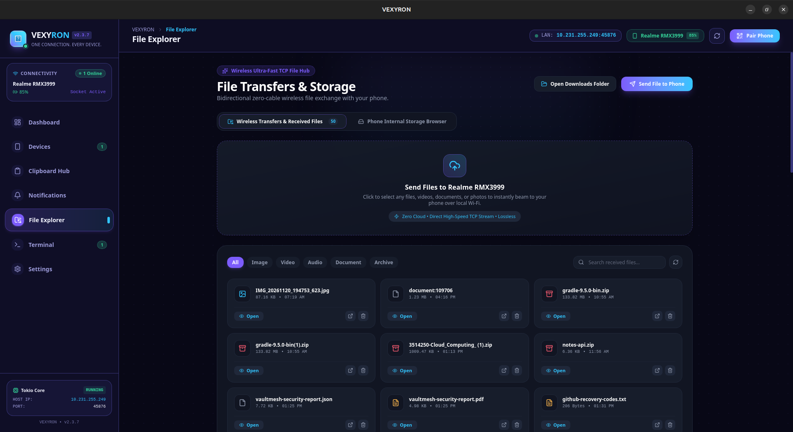
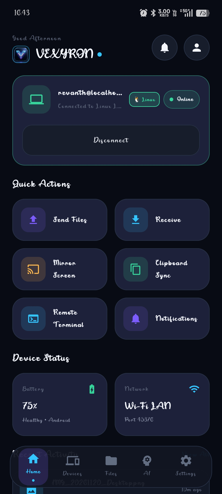
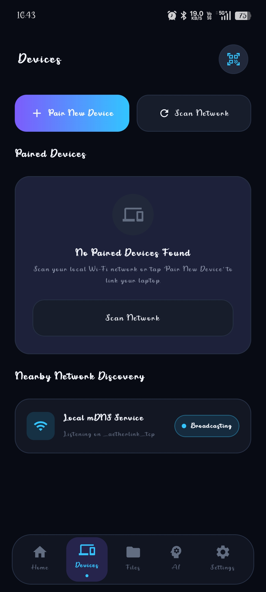
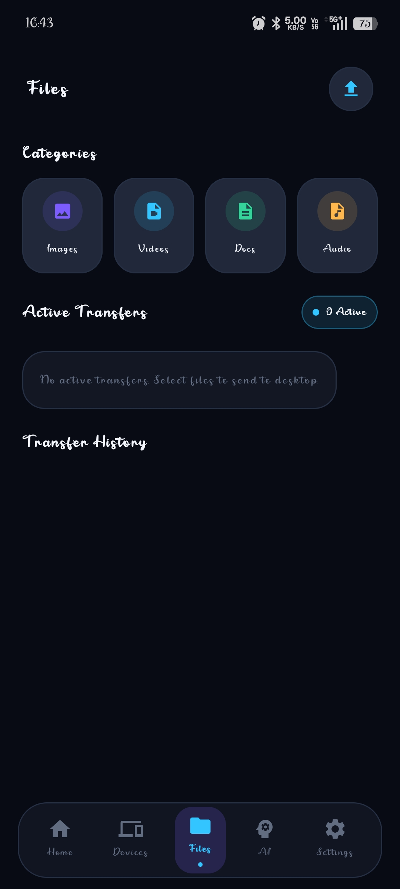
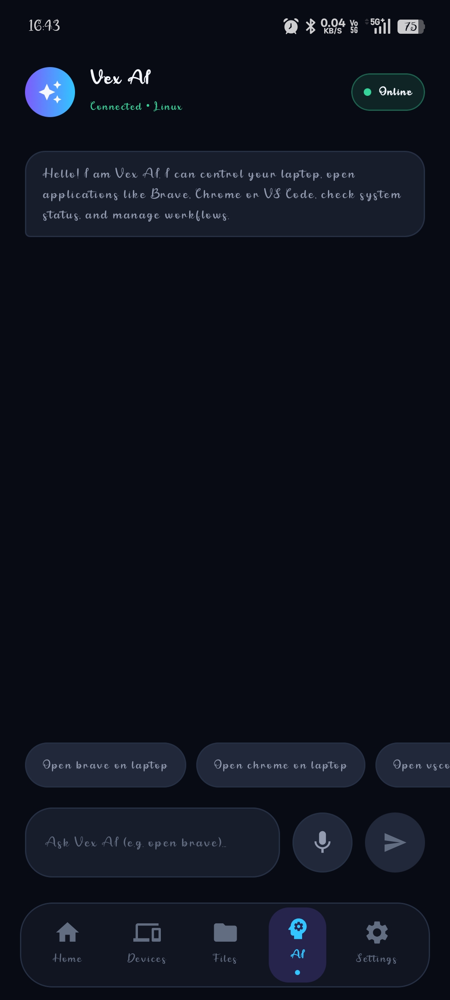
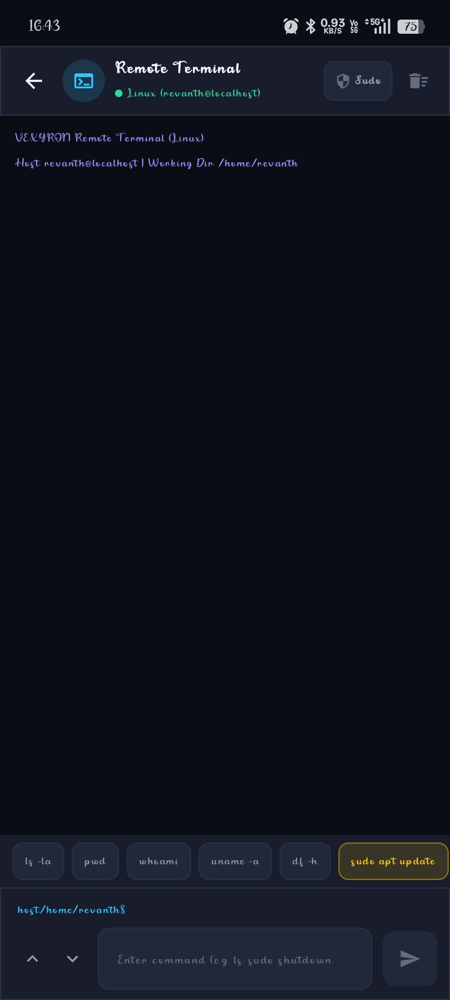
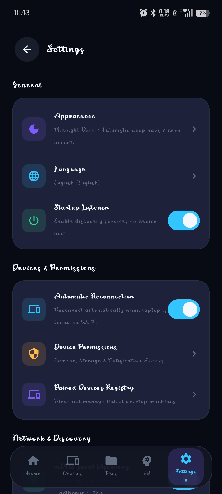

<div align="center">
 
# ⚡ VEXYRON

**High-Performance, Local-First Cross-Device Continuity Ecosystem for Android & Desktop**

[](https://www.rust-lang.org/)
[](https://tauri.app/)
[](https://developer.android.com/jetpack/compose)
[](https://github.com/Rev0nix/VEXYRON/releases)
[](https://github.com/Rev0nix/VEXYRON/releases)
[](.github/workflows/ci.yml)
[](https://github.com/Rev0nix/VEXYRON/releases)
[](LICENSE)

*Unify your Android smartphone and Desktop workstation (Windows & Linux) with zero-config mDNS/NSD discovery, QR handshake pairing, real-time clipboard & notification sync, remote file exploration, bi-directional remote terminal with sudo support, and Vex AI remote application launching.*

</div>

---

## 📖 Overview

**VEXYRON** is a modern, modular ecosystem bridge built to eliminate friction between your mobile device and desktop computer. Designed with a **local-first, privacy-centric architecture**, VEXYRON establishes direct peer-to-peer communication over your local network using custom TCP sockets and multicast DNS (`mDNS` / Android `NSD`), while providing an automated **ADB (Android Debug Bridge)** fallback layer when Wi-Fi client isolation is active.

The platform is engineered as a clean monorepo uniting two native clients around a shared multi-crate Rust core:
* **Desktop Client (`apps/desktop`):** Built with **Rust + Tauri v2 + React + TypeScript + Vite**, delivering ultra-low memory overhead, native OS integration, and a multi-client asynchronous TCP server.
* **Android Client (`apps/android`):** Built with **Kotlin + Jetpack Compose + Material 3**, featuring Clean Architecture (`domain`, `feature`, `service`, `protocol`), foreground background services, Quick Settings tiles, and system overlay widgets.
* **Rust Workspace (`crates/`):** 11 modular domain crates powering protocol framing, device lifecycle management, ADB bridging, pairing cryptography, and extensible plugins.

---

## 📸 Screenshots & Interface

### 💻 Desktop Client (Windows & Linux)

<p align="left">
  
  &ensp;
  
</p>

### 📱 Android Mobile Client

<p align="left">
  
  &ensp;
  
  &ensp;
  
  &ensp;
  
  &ensp;
  
  &ensp;
  
</p>
---

## 🆕 Recent Updates & Cross-Platform Tooling

* **Vex AI Remote App Launcher:** Ask Vex AI on your phone to open applications on your laptop (e.g. *"open brave"*, *"open chrome"*, *"open vscode"*, *"open spotify"*, *"open calculator"*, *"open files"*).
* **Cross-Platform Remote Terminal:** Control your laptop's terminal directly from your Android phone with non-blocking sudo authentication (`-S -p ""`) and automatic typo tolerance.
* **Adaptive Soft Keyboard Insets:** Dynamic `WindowInsets.ime` padding ensuring command bars and action chips elevate smoothly above virtual keyboards.
* **Native In-App Updates:** Windows and Linux desktop clients download and replace older versions in-place without file collisions or duplicate installations.
* **PolyForm Noncommercial License 1.0.0:** Clear noncommercial open usage licensing for personal research, hobby projects, and educational exploration.

---

## ✨ Core Features & Deep-Dive Capabilities

### 🔍 1. Zero-Config Discovery & Cryptographic Handshake Pairing
* **Automatic Subnet Discovery:**
  * **Android:** `NsdDiscoveryManage.kt` and `DiscoveryService.kt` broadcast and resolve `_aetherlink._tcp` services via Android's Network Service Discovery API.
  * **Desktop:** `apps/desktop/src-tauri/src/network/discovery.rs` advertises the workstation and listens for mobile peers on the local network.
* **Instant QR Code & Pin Pairing:**
  * **Mobile Scanner:** `QrCodeScannerHelper.kt` and `PairingScreen.kt` parse connection metadata directly from the desktop QR modal (`PairingModal.tsx`).
  * **Structured Pairing Payloads:** Handshakes are validated through `PairPayloads.kt` (Android) and `crates/device/src/pairing.rs` / `commands/pairing.rs` (Rust).
* **ADB Fallback Bridge:**
  * `crates/device/src/adb.rs` interfaces directly with `adb` to detect USB-connected or wireless-debugging Android devices, forward TCP ports, and maintain connectivity even on restrictive corporate or public networks.

### 💻 2. Cross-Device Remote Terminal & Sudo Engine
* **Bi-Directional Shell Execution:** Execute system commands directly on your connected Windows or Linux laptop from your Android phone.
* **Non-Blocking Sudo Authentication:** Automatically pipes authentication credentials through stdin (`sudo -S -p ""`), avoiding terminal TTY stalling errors.
* **Typo Correction & Smart Normalization:** Auto-normalizes common command slips (e.g. `shotdown` -> `shutdown`, `rebot` -> `reboot`).
* **Quick Command Chips:** Instant access to system commands (`ls -la`, `uptime`, `whoami`, `free -h`, `df -h`, `ip a`, `systemctl status`).

### 🤖 3. Vex AI Assistant & Remote Application Launcher
* **Context-Aware Voice & Text AI:** Interact with Vex AI to control your workspace, query system status, and orchestrate device tasks.
* **Remote App Launching:** Launch desktop applications by voice or prompt—instantly opens Brave, Chrome, VS Code, Spotify, File Manager, Calculator, or YouTube on your laptop.

### 📋 4. Universal Clipboard Synchronization
* **Bidirectional Real-Time Sync:** Any text copied on Desktop (`Clipboard.tsx`) or Android (`ClipboardScreen.kt`) is immediately framed and transmitted across the active TCP session.
* **Deep Android OS Integrations:**
  * **Quick Settings Tile (`ClipboardTileService.kt`):** Push clipboard contents or toggle sync directly from the Android notification shade without opening the app.
  * **Text Selection Context Menu (`ProcessTextActivity.kt`):** Registers Android's `ACTION_PROCESS_TEXT` intent so you can highlight text in any browser or app and tap *"Send to VEXYRON"*.
  * **Background Sync Activity (`ClipboardSyncActivity.kt`):** Handles silent background clipboard capture and dispatch.
  * **Floating Sync Bubble (`FloatingSyncBubbleService.kt`):** An optional overlay widget providing one-tap cross-device clipboard and file actions while multitasking.

### 📁 5. Remote File Explorer & High-Speed TCP Transfer
* **Desktop File Manager (`FileExplorer.tsx`):** Browse your Android device's internal storage from your desktop with full directory traversal, breadcrumb navigation (`Breadcrumb.tsx`), action toolbars (`FileToolbar.tsx`), list views (`FileList.tsx`, `FileItem.tsx`), and right-click context menus (`FileContextMenu.tsx`).
* **Dedicated Transfer Screen (`FileTransferScreen.kt`):** Monitor incoming/outgoing transfers and pick files directly from Android.
* **Chunked Socket Streaming:** Managed by `ConnectionManager.kt` on Android and `tcp_server.rs` / `crates/device/src/file_service.rs` on Rust for reliable binary transfer.

### 🔔 6. Real-Time Notification Mirroring
* **Unified Notification Center:** Android notifications are captured by `NotificationSyncScreen.kt` / `AetherLinkService.kt` and streamed to the desktop `Notifications.tsx` view so you can monitor alerts, messages, and app updates from your workstation.

---

## 🏗️ Monorepo Architecture

```text
VEXYRON-main/
├── .github/
│   └── workflows/
│       ├── ci.yml                      # Automated Rust, Tauri, and Android CI checks
│       └── release.yml                 # Multi-platform release build & packaging workflow
├── apps/
│   ├── android/                        # Native Android Client (Kotlin + Jetpack Compose)
│   │   ├── build.gradle.kts            # Root Gradle configuration (Kotlin DSL)
│   │   ├── gradle/libs.versions.toml   # Centralized version catalog
│   │   └── app/src/main/
│   │       ├── AndroidManifest.xml     # Foreground services, NSD, overlay & intent filters
│   │       └── java/com/aetherlink/android/
│   │           ├── AetherLinkApp.kt    # Application entry & DI initialization
│   │           ├── MainActivity.kt     # Single-activity Compose host
│   │           ├── core/
│   │           │   ├── components/     # Custom UI primitives & buttons
│   │           │   ├── constants/      # AppConstants, NetworkConstants
│   │           │   ├── designsystem/   # Color, Theme, and Typography tokens
│   │           │   └── utils/          # QrCodeScannerHelper
│   │           ├── domain/             # Device & Discovery domain models
│   │           ├── feature/
│   │           │   ├── assistant/      # Vex AI Assistant & remote app launcher
│   │           │   ├── terminal/       # Remote Terminal screen & command executor
│   │           │   ├── clipboard/      # ClipboardScreen & sync activities
│   │           │   ├── devices/        # DevicesScreen & pairing status
│   │           │   ├── files/          # FileTransferScreen & storage explorer
│   │           │   ├── home/           # HomeScreen dashboard
│   │           │   ├── notifications/  # NotificationSyncScreen
│   │           │   ├── onboarding/     # Permission onboarding flow
│   │           │   ├── pairing/        # QR & manual PairingScreen
│   │           │   └── settings/       # SettingsScreen & Linux helpers
│   │           ├── protocol/           # Wire schemas: DeviceInfo, Message, PairPayloads
│   │           ├── service/            # AetherLinkService, ClipboardTileService, DiscoveryService
│   │           └── ui/navigation/      # AppNavigation, BottomBar, Screen routes
│   └── desktop/                        # Cross-Platform Desktop Client (Tauri + React)
│       ├── package.json                # Frontend dependencies & scripts
│       ├── vite.config.ts              # Vite bundler config
│       ├── src/                        # React + TypeScript UI
│       │   ├── components/             # DeviceCard, PairingModal, Sidebar, TopBar
│       │   ├── pages/                  # Dashboard, FileExplorer, Clipboard, Terminal, Settings
│       │   ├── services/tauri.ts       # Typed Tauri IPC invoke wrappers
│       │   └── store/appStore.ts       # Global reactive application state
│       └── src-tauri/                  # Tauri Rust Native Backend
│           ├── Cargo.toml              # Tauri backend dependencies
│           ├── tauri.conf.json         # Window, bundle & capability configuration
│           └── src/
│               ├── main.rs & lib.rs    # Tauri app builder & plugin registration
│               ├── commands/           # IPC handlers: features.rs, pairing.rs
│               └── network/            # discovery.rs & multi-client tcp_server.rs
├── crates/                             # Modular Rust Workspace Crates (11 Crates)
│   ├── ai/                             # AI processing & prompt orchestration
│   ├── common/                         # Shared domain models & constants
│   ├── core/                           # App lifecycle, event bus, device registry
│   ├── crypto/                         # Encryption, key exchange primitives
│   ├── database/                       # Local persistence storage
│   ├── device/                         # DeviceManager, ADB bridge, pairing logic
│   ├── network/                        # Transport & socket traits
│   ├── plugin/                         # Extensible plugin architecture
│   ├── protocol/                       # Cross-platform message framing
│   ├── streaming/                      # Screen & media frame streaming
│   └── sync/                           # Clipboard & state synchronization engine
├── docs/screenshots/                   # UI screenshots (desktop & mobile)
├── deploy-release.sh                   # Automated multi-target release build script
├── launch-desktop.bat                  # Windows Command Prompt quick-launcher
├── launch-desktop.ps1                  # Windows PowerShell quick-launcher
├── launch-desktop.sh                   # Linux/macOS Bash quick-launcher
├── LICENSE                             # PolyForm Noncommercial License 1.0.0
└── README.md
```

---

## 🛠️ Technology Stack

| Subsystem | Technologies & Frameworks |
| :--- | :--- |
| **Desktop Shell & Backend** | Rust (2021 Edition), Tauri v2, Tokio Async Runtime, Custom TCP Server (`tcp_server.rs`) |
| **Desktop Frontend** | React, TypeScript, Vite, Tailwind CSS, Custom Reactive Store (`appStore.ts`), Typed IPC (`tauri.ts`) |
| **Android Application** | Kotlin, Jetpack Compose, Material 3, Custom Design System, Android NSD, Foreground Services |
| **Core Engine & Protocol** | Cargo Workspace (`11` modular crates), Custom Wire Protocol (`crates/protocol`), ADB Bridge (`adb.rs`) |
| **CI/CD & Packaging** | GitHub Actions (`ci.yml`, `release.yml`), Gradle Kotlin DSL (`libs.versions.toml`), `deploy-release.sh` |

---

## 🚀 Getting Started

### Prerequisites

* **Rust Toolchain:** Latest stable `rustc` & `cargo` via [rustup.rs](https://rustup.rs/)
* **Node.js & npm:** Node.js `v18+` and `npm`
* **Android Studio / SDK:** JDK `17+` and Android SDK (API 34+)
* **ADB (Recommended):** Android Platform Tools installed and available in your system `PATH`
* **Linux System Libraries (Linux only):**
  ```bash
  sudo apt update && sudo apt install -y libwebkit2gtk-4.1-dev build-essential \
    curl wget file libxdo-dev libssl-dev libayatana-appindicator3-dev librsvg2-dev
  ```

---

### 1. Clone the Repository

```bash
git clone https://github.com/Rev0nix/VEXYRON.git
cd VEXYRON

# Build all 11 workspace crates
cargo build --workspace
```

---

### 2. Launch the Desktop Client

#### Option A: Running from Prebuilt Release Packages
* **Windows:** Download [`VEXYRON-Windows-Setup.exe`](https://github.com/Rev0nix/VEXYRON/releases/latest) and run the installer. Installs per-user and supports seamless in-app updates.
* **Linux (Ubuntu / Debian):** Download [`VEXYRON-Linux.deb`](https://github.com/Rev0nix/VEXYRON/releases/latest) and install via terminal:
  ```bash
  sudo apt install ./VEXYRON-Linux.deb
  ```

#### Option B: Running from Source / Development Mode
You can use the included cross-platform quick-launch scripts from the repository root:
* **Windows (Command Prompt):**
  ```cmd
  launch-desktop.bat
  ```
* **Windows (PowerShell):**
  ```powershell
  .\launch-desktop.ps1
  ```
* **Linux / macOS:**
  ```bash
  chmod +x launch-desktop.sh
  ./launch-desktop.sh
  ```

---

### 3. Build & Install the Android App

```bash
cd apps/android

# Build the release or debug APK
./gradlew assembleDebug

# Install onto a connected Android device via ADB
adb install -r app/build/outputs/apk/debug/app-debug.apk
```

Or download the pre-signed release package directly from [GitHub Releases](https://github.com/Rev0nix/VEXYRON/releases/latest).

---

## 🤝 Contributing

1. **Fork** the repository and create a feature branch (`git checkout -b feature/your-feature`).
2. **Verify Rust & Desktop checks:** Run `cargo test --workspace` and `npm run build` inside `apps/desktop`.
3. **Verify Android checks:** Run `./gradlew test` inside `apps/android`.
4. **Commit & Push** your changes and open a Pull Request.

---

## 📄 License

This project is licensed under the **PolyForm Noncommercial License 1.0.0**.

### Summary of Terms:
* **Permitted Noncommercial Use:** You may freely run, test, experiment with, modify, and distribute this software for any noncommercial purpose—including personal study, research, hobby projects, private entertainment, and use by educational or noncommercial organizations.
* **Commercial Restrictions:** You may not exercise any rights granted by this license for commercial purposes (including selling, commercial hosting, or monetized distribution) without obtaining a separate commercial license from the licensors.
* **Attribution & Notices:** All distributions of this software or modified works must retain the copyright notices and a copy of the license terms.

For the full legal terms and conditions, please read the complete [`LICENSE`](LICENSE) file.
